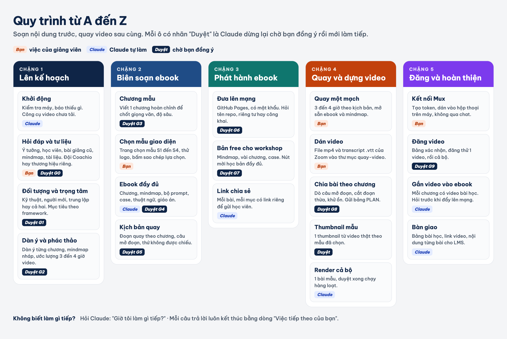
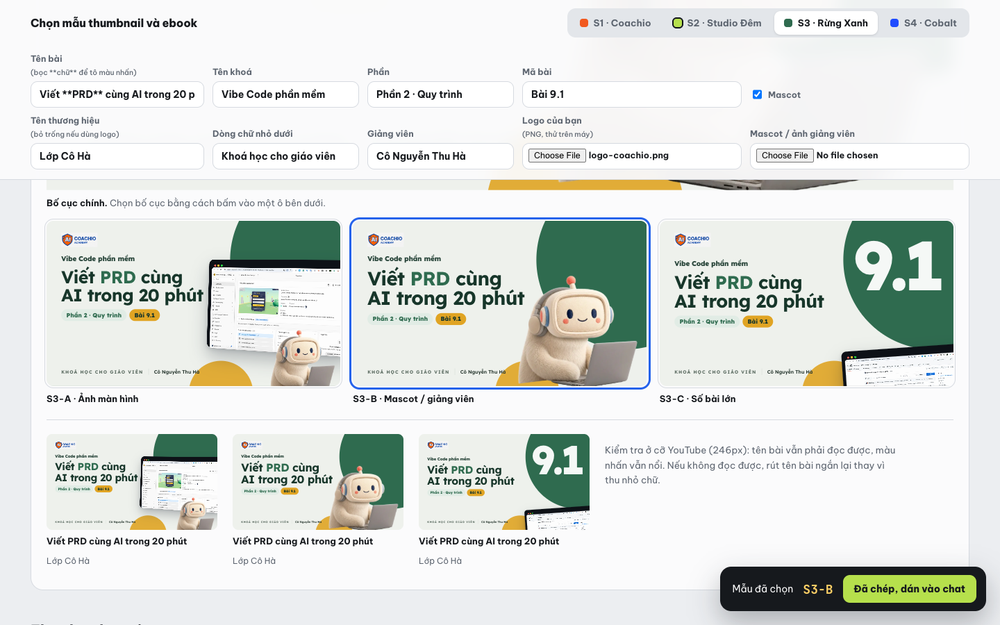
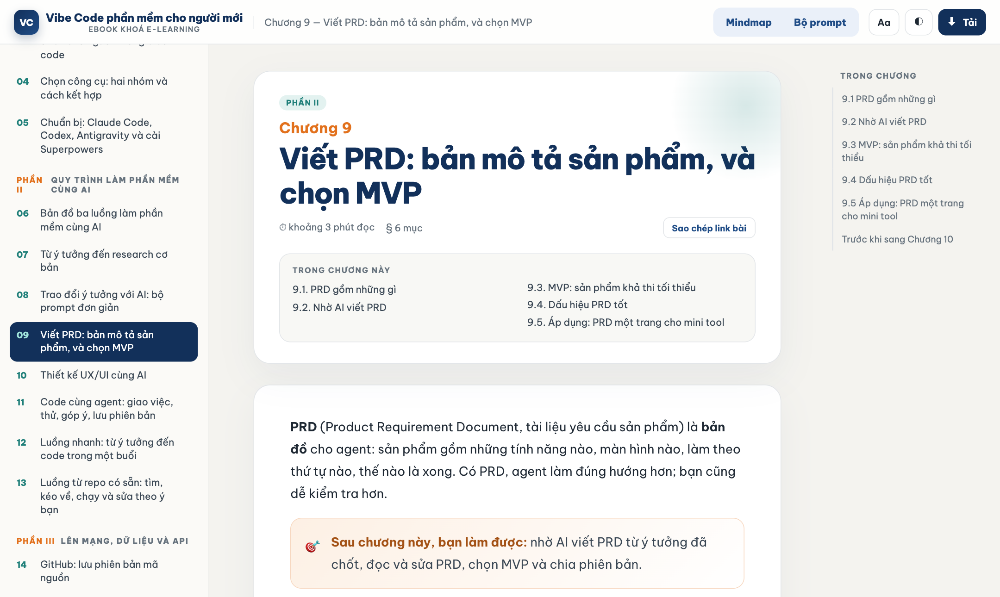
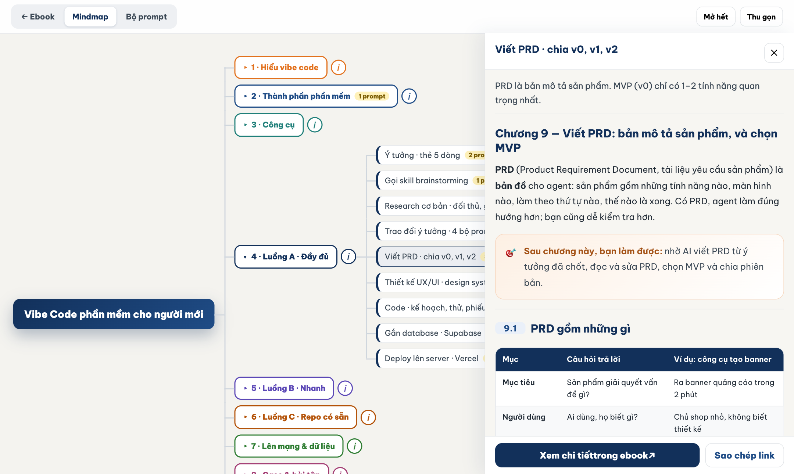
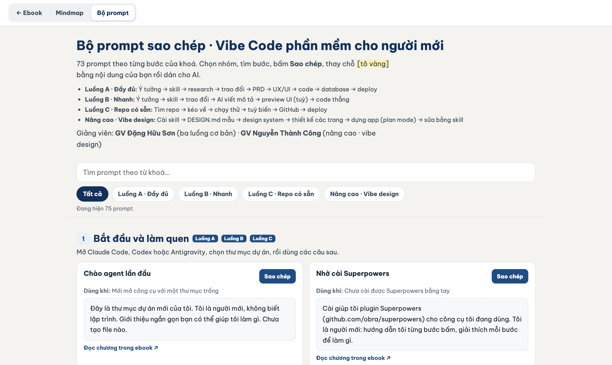
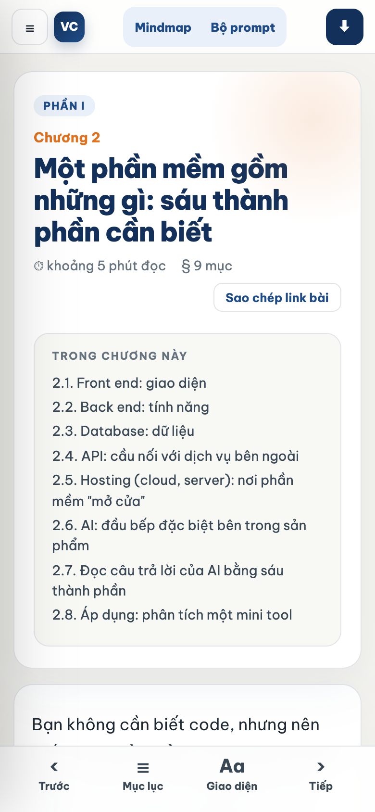
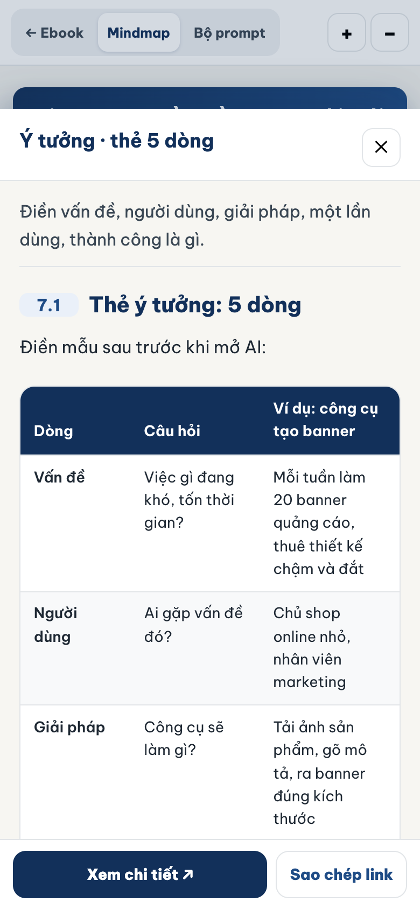

# ebook-to-elearning

**Bộ skill cho Claude giúp chuyên gia, giảng viên làm trọn một khoá e-learning:** soạn dàn ý, ebook, mindmap, bộ prompt trước; quay video sau cùng; rồi cắt thành bài học, làm thumbnail, đăng lên Mux.

Bạn chỉ cần **trả lời câu hỏi, duyệt, quay video và dán video vào một thư mục**. Mọi việc còn lại Claude làm, và luôn hỏi bạn trước những bước quan trọng.



---

## Bạn chỉ làm 5 việc

| # | Việc của bạn | Claude lo phần còn lại |
|---|---|---|
| 1 | Trả lời câu hỏi, gửi tư liệu đã có (bài giảng cũ, mindmap, tài liệu, link) | Đọc hết, lên kế hoạch khoá học theo các framework thiết kế bài giảng |
| 2 | Duyệt và chỉnh: dàn ý, chương mẫu, ebook, kịch bản quay | Viết ebook, mindmap, bộ prompt, case study, thuật ngữ, giáo án |
| 3 | Quay video một mạch 3 đến 4 giờ theo kịch bản | |
| 4 | Dán video vào thư mục `quay-video/` (Zoom: file MP4 và file transcript .vtt) | Chép lời, chia bài theo chương, cắt đoạn thừa, khử ồn, làm thumbnail |
| 5 | Duyệt thumbnail mẫu, bài mẫu; đồng ý trước khi đăng | Dựng cả bộ, đăng Mux, gắn video vào ebook, bàn giao |

Lúc nào không rõ, chỉ cần hỏi: **"Giờ tôi làm gì tiếp?"**. Mỗi câu trả lời của Claude luôn kết thúc bằng dòng *Việc tiếp theo của bạn*.

---

## Quy trình từ A đến Z

### Chặng 1 · Lên kế hoạch

1. **Khởi động.** Claude kiểm tra máy, báo còn thiếu gì. Công cụ làm video chưa tải ở bước này cho nhẹ máy.
2. **Hỏi đáp và tư liệu (duyệt G0).** Ý tưởng khoá học, học viên là ai, tư liệu đã có. Khoá thuộc đội Coachio hay thương hiệu riêng.
3. **Đối tượng và trọng tâm (duyệt G1).** Chọn: thuần kỹ thuật, dành cho người mới, trung lập, hay cả hai. Claude đặt mục tiêu khoá theo framework (Backward Design, Bloom, Action Mapping…).
4. **Dàn ý và phác thảo (duyệt G2).** Dàn ý từng chương, ý chính sẽ nói, mindmap nháp, ước lượng thời lượng video. **Chưa viết nội dung trước khi bạn duyệt bước này.**

### Chặng 2 · Biên soạn ebook

5. **Chương mẫu (duyệt G3).** Một chương hoàn chỉnh để chốt giọng văn và độ sâu.
6. **Chọn mẫu giao diện.** Trang chọn mẫu mở trên trình duyệt: 4 phong cách × 3 bố cục thumbnail. Bạn thử logo, mascot của mình, bấm **Sao chép lựa chọn** rồi dán vào chat.
7. **Ebook đầy đủ (duyệt G4).** Toàn bộ chương, mindmap, bộ prompt, case study, thuật ngữ, giáo án.
8. **Kịch bản quay (duyệt G5).** Mỗi đoạn quay ứng với một chương, có câu mở đoạn và danh sách thứ không được chiếu (đăng nhập, email, mật khẩu).

### Chặng 3 · Phát hành ebook

9. **Đưa lên mạng (duyệt G6).** GitHub Pages, có mật khẩu. Claude hỏi tên repo, riêng tư hay công khai trước khi đẩy.
10. **Bản free cho workshop (duyệt G7).** Mindmap, vài chương, case; cuối mỗi chương có nút mời học bản đầy đủ.
11. **Link chia sẻ.** Mỗi bài, mỗi mục có link riêng và nút sao chép, gửi học viên là mở đúng chỗ.

### Chặng 4 · Quay và dựng video

12. **Quay một mạch** theo kịch bản, mở sẵn ebook và mindmap để trình bày.
13. **Dán video** vào `quay-video/`. Với Zoom Cloud: tải **Shared screen with speaker view (MP4)** và **Audio transcript (VTT)**.
14. **Chia bài theo chương (duyệt G8).** Claude dò câu mở đoạn để chia bài, cắt đoạn thừa, gửi bảng PLAN.
15. **Thumbnail mẫu.** Một thumbnail làm từ video thật theo mẫu đã chọn. Bạn duyệt rồi mới làm cả bộ.
16. **Render cả bộ.** Một bài mẫu để duyệt, sau đó chạy hàng loạt (có thể để máy chạy qua đêm).

### Chặng 5 · Đăng và hoàn thiện

17. **Kết nối Mux.** Tạo Access Token trong dashboard.mux.com, dán vào hộp thoại hiện trên máy (không dán vào chat).
18. **Đăng video (duyệt G9).** Bảng xác nhận, đăng thử 1 video, rồi cả bộ.
19. **Gắn video vào ebook.** Mỗi chương có khung video bài học.
20. **Bàn giao.** Bảng bài học, link video, mô tả từng bài để đưa lên LMS.

---

## Hình ảnh sản phẩm

### Trang chọn mẫu thumbnail và ebook

4 phong cách: **S1 Coachio · S2 Studio Đêm · S3 Rừng Xanh · S4 Cobalt**. 3 bố cục: **A ảnh màn hình · B mascot / giảng viên · C số bài lớn**. Mã mẫu ví dụ `S3-B`.



### Thumbnail thật dựng từ mẫu


### Ebook đọc trên máy tính

Mục lục bên trái, nội dung ở giữa, mục lục chương bên phải. Tab **Mindmap** và **Bộ prompt** luôn ở thanh trên.



### Mindmap dùng để trình bày

Bấm một ý là bảng bên phải hiện luôn nội dung bài để đọc. Cuối bảng có **Xem chi tiết trong ebook** (luôn mở lại đúng một tab ebook, không mở thêm tab) và **Sao chép link**.



### Bộ prompt sao chép

Lọc theo nhóm, tìm kiếm không dấu, nút sao chép. Chỗ cần tự điền được tô vàng.



### Trên điện thoại

<p>

&nbsp;&nbsp;

</p>

---

## Cài đặt

**Cần có:** máy Mac, ứng dụng Claude (Claude Code hoặc Claude Desktop), Python 3, quyền truy cập repo này trên GitHub.

1. Tải repo về máy (bấm **Code → Download ZIP** rồi giải nén, hoặc nhờ Claude: *"Tải repo này về máy giúp tôi: https://github.com/sonlovinbot/ebook-to-elearning"*).
2. Chạy một lệnh (hoặc nhờ Claude chạy):

   ```bash
   zsh ebook-to-elearning/install.sh
   ```

3. Mở Claude và nói: **"Khởi động ebook-to-elearning"**, hoặc nói luôn chủ đề khoá học.

Claude sẽ kiểm tra máy, báo thứ gì còn thiếu, và **hỏi bạn trước khi cài bất cứ thứ gì**.

---

## Các skill trong bộ

| Skill | Làm gì | Khi nào được cài |
|---|---|---|
| **ebook-to-elearning** | Hỏi đáp, thiết kế bài giảng, dàn ý, ebook, mindmap, bộ prompt, kịch bản quay, bản free, đưa ebook lên mạng | Ngay khi cài |
| **video-to-elearning** | Cắt video dài thành bài học: chép lời, chia bài, cắt đoạn thừa, khử ồn, thumbnail theo mẫu, intro, render | Khi tới bước video (Claude hỏi trước) |
| **mux-publisher** | Đăng video lên Mux, lấy link và mã nhúng, thư mục bàn giao cho LMS | Cùng lúc với video-to-elearning |

Tuỳ chọn: **Mux MCP** (connector `https://mcp.mux.com` trong Claude) để hỏi Claude về video đã đăng. Xem [docs/KET-NOI-MUX.md](docs/KET-NOI-MUX.md).

---

## Những gì sẽ được tải về máy

Mọi thứ đều **hỏi bạn trước**, và chỉ tải khi thật sự cần.

| Khi nào | Tải gì | Dung lượng (ước) |
|---|---|---|
| Lúc cài | Vài thư viện Python để dựng ebook (đọc Markdown, xử lý ảnh, xuất PDF/EPUB, mã hoá mật khẩu) | khoảng 100 MB |
| Muốn xuất PDF, làm ảnh bìa | Google Chrome (thường máy đã có) | |
| Tới bước video | Skill video-to-elearning và mux-publisher | khoảng 15 MB |
| Tới bước video | FFmpeg (cắt, ghép, lọc âm thanh) | khoảng 100 MB |
| Tới bước video | Remotion và trình duyệt kèm theo (dựng thumbnail, intro) | khoảng 340 MB |
| Chỉ khi **không có** transcript Zoom | Whisper và mô hình chép lời tiếng Việt | khoảng 1,6 GB |
| Bạn tự cài nếu máy chưa có | Node.js, Homebrew (cần mật khẩu máy) | |
| Khi đăng video | Tài khoản Mux và Access Token (bạn tự tạo) | |

**Mẹo:** quay trên Zoom Cloud và tải kèm file transcript .vtt thì không cần tải Whisper, chép lời nhanh và chính xác hơn nhiều.

---

## Tài liệu thêm

| Tài liệu | Nội dung |
|---|---|
| [HUONG-DAN.md](HUONG-DAN.md) | Hướng dẫn sử dụng chi tiết |
| [docs/QUY-TRINH.md](docs/QUY-TRINH.md) | Vì sao làm theo thứ tự này |
| [docs/HOI-DAP.md](docs/HOI-DAP.md) | Bộ câu hỏi Claude sẽ hỏi |
| [docs/FRAMEWORKS.md](docs/FRAMEWORKS.md) | Các framework thiết kế bài giảng |
| [docs/THUONG-HIEU.md](docs/THUONG-HIEU.md) | Chọn mẫu, logo, màu thương hiệu |
| [docs/QUAY-VIDEO.md](docs/QUAY-VIDEO.md) | Chuẩn bị quay một mạch 3 đến 4 giờ |
| [docs/KET-NOI-MUX.md](docs/KET-NOI-MUX.md) | Kết nối tài khoản Mux |
| [docs/BAN-FREE.md](docs/BAN-FREE.md) | Bản free cho workshop |
| [SKILL.md](SKILL.md) | Quy tắc cho Claude (tiếng Anh) |

Ví dụ thật: [examples/vibe-code-phan-mem](examples/vibe-code-phan-mem) là cấu hình của ebook *Vibe Code phần mềm cho người mới* (Coachio Academy, 10/2026).
